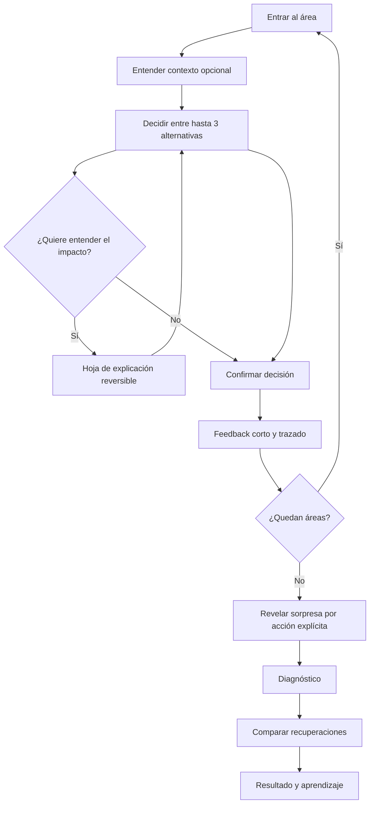

# Implementación 2 · Roadmap de ejecución rebaselado (23-10-2026)

> **Documento ejecutivo y de entrega.** El inventario técnico canónico sigue siendo [I2-PLAN-MAESTRO.md](I2-PLAN-MAESTRO.md), con 41 microfases **I2-00 a I2-40**. Este documento no duplica IDs ni declara funciones implementadas por haber escrito un plan. [Estado verificable](I2-STATUS.md).

## 1. Decisión de producto y alcance

El simulador V1 **v11.68 r177** es un laboratorio valioso por sus decisiones, datos, 3 SKU, 8 áreas, compras originales, 12 días, restricciones físicas, comparaciones y costos parciales. Se conserva operable e independiente. **Misión CD** será un **segundo cliente UX** en `/juego/`, bajo el mismo GitHub Pages, orientado a **un gerente principiante usando un teléfono**. El usuario decide, aprende, observa efectos y puede abrir trazabilidad profunda sin necesitarla para avanzar.

**No construir un videojuego convencional** (sin 3D, avatares pesados ni economía de puntos inventada). Construir una experiencia guiada, amable, didáctica y gamificada. Debe heredar la identidad oscura y las reglas de V1, con naranja como acento principal y un guía **opcional**, nunca invasivo. Mantener la fuente de verdad numérica en `src/`; no duplicar fórmulas en el frontend del juego.

### Lo que se conserva / lo que se transforma

| Conservar sin reinterpretar | Transformar en el modo juego |
| --- | --- |
| Ocho áreas y secuencia Comercial → Planning → Compras → Recepción → Calidad → Inventario → Picking → Transporte | Una área por escena, con progreso y decisión breve |
| Demanda esperada vs real, demanda sorpresa y plan congelado | Revelación explícita y narrativa del cambio de demanda |
| 3 SKU; compras, lead times, inventario y flujo de 12 días | Consecuencias en lenguaje común; detalle SKU bajo demanda |
| Cinco recuperaciones y contrafactual de base común | Tarjetas comparables: mejora física, plazo y costo conocido/desconocido |
| KPIs, eventos, costos y sus límites epistemológicos | Máx. dos KPI iniciales por área; detalles y fórmulas opcionales |
| Seguridad del estado y motor determinista | Guardado aislado, volver/reintentar y escenarios con seed fija |

**No mezclar horizontes:** modelo de jornada agregada ≠ cohorte SKU de 12 días. «Preparado» ≠ «expedido» ≠ «entregado al cliente». Una PO no equivale a recepción. Costo desconocido nunca se convierte en cero.

## 2. Cierre de auditoría anterior y asuntos reales

- **I2-00:** PR [#71](https://github.com/harrysxavio/cd-simulator/pull/71) fusionado (SHA `675d0945daca8d510caef127c70a6265ead45b95`), suites Node, Chromium, Pages y comprobación HTTP aprobadas en main. **1/41 integrado técnicamente**.
- La matriz estática identificó **32 botones**; hay controles JS dinámicos y rutas adicionales. Los E2E prueban recorridos representativos; no se declara que cada botón funcione en cada combinación de estado. Cobertura exhaustiva se construye en **I2-36** y manual humano en I2-38.
- Evidencia de fricción móvil en Chromium emulado 360×760: documento 3.134 px (~4,12 pantallas); CTA Continuar comienza a 2.769 px. Esto acredita deuda de scroll, no fallo de motor ni aceptación física.
- **Defecto real V1:** [issue #73](https://github.com/harrysxavio/cd-simulator/issues/73), ayuda de Comercial/Planning ante forecast optimista/sobrecobertura; abordar con PR V1 separado y tests, sin aprovechar para rediseñar todo V1.
- **Puertas manuales abiertas:** [issue #67](https://github.com/harrysxavio/cd-simulator/issues/67), Android real, TalkBack y comprensión principiante. No declarar release estable sin firmas y evidencia.
- No hacer cambios V1 cosméticos masivos; primero corregir defectos reproducibles y garantizar no regresión.

## 3. Nueve fases ejecutivas y 41 microentregas

| Fase | Microfases | Resultado observable | Gate para cerrarla |
| --- | --- | --- | --- |
| **F0 · Auditoría y baseline** | I2-00 | Auditoría, cobertura real, UX, evidencia y plan | PR/merge + Node + Chromium + Pages/HTTP; documentar limitaciones |
| **F1 · Dos modos navegables** | I2-01–03 | Contratos definidos; ruta del juego real; botón Jugar y Volver | Sesiones independientes; URL y vuelta atrás; V1 sin regresión |
| **F2 · Datos seguros y mismos números** | I2-04–06 | Adaptador puro, storage aislado, guardas SKU/economía | Igualdad exacta baseline/PO/ledger entre V1 y juego; recarga/corrupción |
| **F3 · Ergonomía móvil y guía** | I2-07–12 | Orange theme, shell, footer fijo, progreso, ayuda/guía opcional | En 360×760 elegir y continuar con **0 scroll externo**; teclado, foco, 320 px |
| **F4 · Primera misión configurada** | I2-13–17 | Portada, modos novato/experto, configurar, briefing, decisión reusable | Empezar sin configurar; ayuda saltable; editar/cancelar; una elección real |
| **F5 · Ocho áreas jugables** | I2-18–25 | Cada área Entender → Decidir → (Impacto opcional) → Confirmar | Consecuencias trazadas, una opción activa, forecast previo al shock, sin doble motor |
| **F6 · Sorpresa y recuperación** | I2-26–30 | Revelar, diagnosticar y gerenciar 5 recuperaciones | Misma cohorte/base, compras originales congeladas, deadlines y costos correctos |
| **F7 · Resultados y juego pedagógico** | I2-31–35 | Cierre, timeline, economía honesta, insignias, niveles y replay | Reintento con seed; diferencia intervención/baseline trazada; sin puntaje ficticio |
| **F8 · QA, usuarios y publicación** | I2-36–40 | Matriz exhaustiva, pruebas físicas, accesibilidad y release controlado | Node/E2E/HTTP + Android/TalkBack + comprensión humana + V1 intacta |

**Estado de F0 (23-10):** técnicamente concluida, con documentación de seguimiento regularizada en esta propuesta. F1–F8 no desarrolladas. **1/41 = 2,4 %** de entregas integradas; esto no significa 2,4 % de esfuerzo ni que el modo juego exista.

### Hitos de producto para revisar con el usuario

1. **Hito A: dos entradas reales (F1):** botón de entrada solo tras existir `/juego/`. En este punto existe navegación, **no aún un juego utilizable**.
2. **Hito B: prueba tangible en teléfono (F3–F4):** presentar una pantalla real de decisión con cabecera, avance y ayuda sin scroll externo; revisar legibilidad y carga cognitiva **antes de crear ocho áreas**.
3. **Hito C: flujo de decisiones completo (F5):** ocho áreas conectadas al mismo contrato SKU y ejecución reproducible; todavía no se declara campaña terminada.
4. **Hito D: primera campaña cerrable (F6):** shock, diagnóstico, alternativa de recuperación y confirmación permiten completar el ciclo operativo.
5. **Hito E: experiencia educativa completa (F7–F8):** explicar qué pasó y por qué, logros válidos, pruebas físicas y publicación.

## 4. Contrato UX obligatorio de cada escena

**Estructura única**: cabecera compacta (área, 1/8, salir) + panel central de scroll **interno** (situación, 1 KPI, opciones, pregunta «¿Por qué?») + pie de acción estable (Atrás / Siguiente o Confirmar). El usuario jamás necesita volver arriba para encontrar la acción.

**Microflujo:**

**Reglas:**
- Una decisión focal por vista, tarjetas táctiles ≥44 px (objetivo 48), texto de acción breve y unidad junto al número. El contenido avanzado se abre opcionalmente.
- El usuario puede leer qué significa un KPI, por qué importa y el impacto **potencial** antes de elegir. No anticipar demanda real ni mostrar mejoras garantizadas antes del contrafactual.
- Confirmar congela la decisión de manera explícita; retroceder para consultar no altera compras o contadores. Cuando sea irreversible, se indica y existe «Reintentar caso».
- Ayuda/personaje «Nico» optativo con frases cortas; debe poder desactivarse. Aprendizaje no bloquea navegación y no requiere leer cada descripción.
- Configuración simple por defecto; avanzada plegable con Guardar / Cancelar. Modificar parámetros cambia baseline **solo al iniciar/reiniciar** según el contrato.
- No presentar «Costo total» a partir de montos incompletos o de horizontes distintos; cuando falten componentes, rotular **costo conocido parcial** y revelar supuestos.
- Insignias por comprensión demostrada, no por gastar, hacer clic o contratar más recursos. Usar 3 ejes transparentes (servicio, costo conocido, espera), no puntuación monetaria inventada.

## 5. Criterios técnicos y medición de adopción

**Reutilización:** separar `game/app.js` de `src/app.js`; game-adapter sobre módulos puros, mismos 3 SKU/PO/ledger/8 áreas/5 recuperaciones. `localStorage` del juego separado y migrable. Sin backend, datos personales, tokens ni APIs externas por defecto.

**Móvil:** probar 320×568, 360×760, 390×844, 412×915 y 430×932, textos al 200 %, portrait/landscape, teclado, contraste WCAG AA, `prefers-reduced-motion`, recarga/offline dentro de alcance de Pages. CTAs nunca tapados por navegador/teclado. Medir overflow horizontal, scroll externo para confirmar, tamaño táctil, errores de consola, restauración de foco, navegación teclado.

**Comprensión real:** probar con al menos una persona que no conozca logística. Después de una misión debe distinguir: compra vs recepción; preparado vs expedido; planificación vs demanda observada; costo incompleto vs cero. Registrar tareas completadas, dudas, fricción y ajustes sin confundir opiniones con evidencia estadística.

**Pruebas de regresión:** sobre/subforecast, cambios de abastecimiento, proveedor tardío, cola de recepción, calidad retenida, reserva sin stock, picking/transporte limitados, día 13 sin rescate, recuperación combinada no aditiva, cinco alternativas con baseline inmutable. Sin duplicar unidad ni inventar stock.

**Definición de terminado por microfase:** rama corta → cambio acotado → test unitario o E2E relevante → regresión V1 + juego → PR → merge a main → verificación Pages/HTTP si aplica → evidencia concreta en I2-STATUS. Si falta aceptación manual, **bloqueada/en curso**, no «100 %».

## 6. Plan de ejecución inmediata (sin grandes épicas)

| Orden | Trabajo | Entregable |
| --- | --- | --- |
| 0 | Resolver/validar #73 en PR V1 independiente | Explicación Comercial/Planning sin excepciones y test de regresión |
| 1 | **I2-01** definir contrato de campaña/decisión/scope V1–I2 | Tabla de 8 áreas, 3 SKU, 5 recoveries, esquema firmado por tests |
| 2 | **I2-02** crear URL estática `/juego/` | Ruta directa recargable, error/fallback y volver |
| 3 | **I2-03** habilitar botón solo con ruta aprobada | Ida/vuelta por teléfono y teclado, preservando V1 |
| 4 | **I2-04–06** integrar adaptador y persistencia aislados | Baseline idéntico, cero fugas de scope |
| 5 | **I2-07–12** montar shell móvil antes de llenar contenido | Primer experimento con 0 scroll externo para decidir |
| 6 | **I2-13–17** validar una decisión pedagógica de extremo a extremo | UX evaluable con usuario novato antes de clonar a 8 áreas |

**Condición para acelerar:** se puede trabajar en microfases consecutivas en un mismo turno de agente, pero **cada una debe tener PR, gate y estado verificable**. No cerrar por lotes sin CI. La siguiente microfase formal es **I2-01**. El modo jugable completo no debe prometerse antes de I2-30, y el release no antes de I2-40.

## 7. Exclusiones deliberadas

3D, multiplayer, pagos, ranking competitivo mundial, CRM, analítica de personas, agentes IA con costos externos y gamificación dependiente de servidor. Cualquier expansión posterior se tramita como decisión separada con justificación de valor, mantenimiento, datos y costo.
